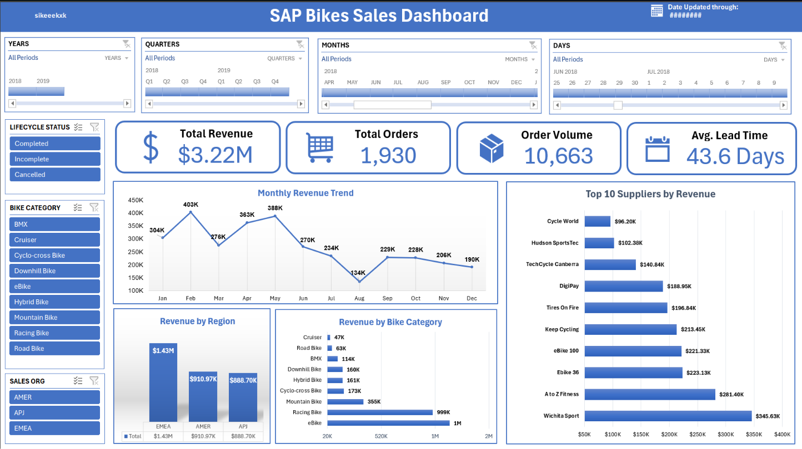
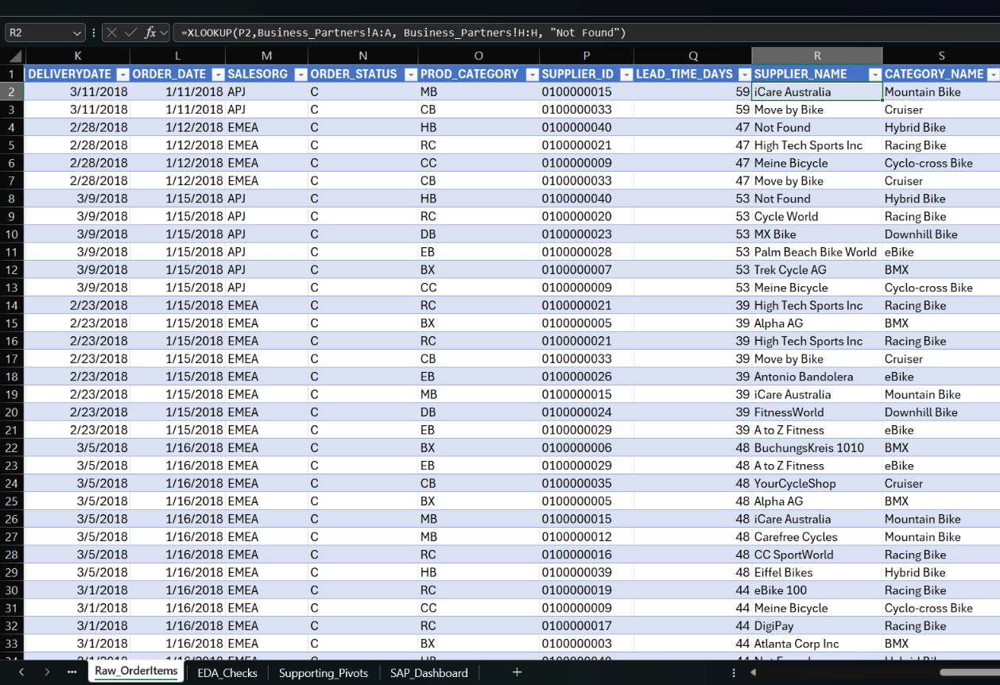
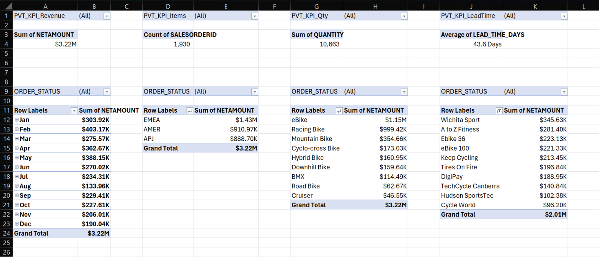

# SAP Bikes Sales Dashboard

## Project Overview
The goal of this project is to tell a clear story from raw business data. Instead of looking at scrambled numbers across separate spreadsheets, I built an interactive Excel dashboard that visualizes sales performance, supplier contribution, and order status in a way that is easy for the business to understand and use for decision making.

## Dataset Source
* **Source:** [SAP Bikes Sales Sample Data on Kaggle](https://www.kaggle.com/datasets/yasinnaal/sap-bikes-sales-sample-data)
* **Origin:** Official SAP ERP and SAP Datasphere (Warehouse Cloud) Global Bike sample content (Public Domain CC0).
* **Files Included:** 9 relational CSV files (`SalesOrders.csv`, `SalesOrderItems.csv`, `Products.csv`, `ProductTexts.csv`, `ProductCategories.csv`, `ProductCategoryText.csv`, `BusinessPartners.csv`, `Addresses.csv`, and `Employees.csv`) stored inside the [`dataset/`](dataset/) folder.

## Business Questions
Before building the Pivot Tables and charts, I outlined four main questions that the business needs to answer from this dataset:
1. How is overall sales revenue performing across months and quarters from 2018 to 2019, and what is our average delivery lead time?
2. Which sales region (`EMEA`, `AMER`, or `APJ`) brings in the highest revenue?
3. Which bike categories drive the majority of company sales, and which categories are underperforming?
4. Who are our top 10 suppliers by revenue, and are there any incomplete or cancelled order bottlenecks affecting our numbers?

## Data Cleaning and Preparation
The raw datasets were structured across multiple tables and had several formatting issues. Before creating the Pivot Tables and charts, I cleaned and consolidated the records into a main working table (`Raw_OrderItems`):

1. **Joining Tables with `XLOOKUP`:** The order items table (`1,930 rows`) only contained ID codes. I used `XLOOKUP` to pull the order dates, sales regions (`SALESORG`), and lifecycle statuses from the `SalesOrders` table, along with product categories and supplier names from the master data tables.
2. **Handling Missing Supplier IDs:** While matching supplier names, 79 rows (`HB-1175` and `HB-1176`) returned `"Not Found"` because their supplier IDs (`0100000040` and `0100000041`) were missing from the `BusinessPartners` table. Adding the `"Not Found"` fallback in `XLOOKUP` kept the dataset clean and prevented `#N/A` errors from breaking the Pivot Tables.
3. **Formatting SAP Dates:** The raw dates were stored as 8-digit numbers like `20180111` (`YYYYMMDD`), which Excel could not group by month or year. I converted them into standard Excel dates using the *Text to Columns (`YMD`)* tool.
4. **Addressing Cancelled Orders and Dummy Dates:** Several records had a delivery date set to `2999-12-12`. Checking their lifecycle status showed that all of these orders were marked as `X` (Cancelled). I used an `IF` formula (`=IF(N2="X", "", K2-L2)`) when calculating delivery lead time so cancelled orders would not skew the average lead time. I also renamed the status codes `C`, `I`, and `X` to **Completed**, **Incomplete**, and **Cancelled** on the slicer for clarity.
5. **Removing Empty Columns:** I excluded columns that only contained blanks or empty spaces (`OPITEMPOS` and `NOTEID`) and checked the dataset for duplicate order items.

## Key Insights from the Dashboard
In the unfiltered view shown on the dashboard, total order value across all 1,930 items (`10,663 units`) is **$3.22M** with an average lead time of **43.6 days**. When filtered strictly to **Completed** orders (`1,800 items` and `9,944 units`), realized revenue is **$3.03M** with an average lead time of **45.9 days**.

### 1. Strong Early 2019 Sales and the June 2019 Bottleneck
Sales in the first quarter of 2019 performed very well. Completed revenue in **Q1 2019 (`$545.6K`)** was significantly higher than in **Q1 2018 (`$437.0K`)**. This aligns with warmer weather and peak cycling and racing events during the start of the year.

However, looking closely at **June 2019** reveals why second quarter completed revenue dropped. June 2019 had the highest volume of **Incomplete orders at `$143.82K` (around `$144K`)**, which explains why completed revenue fell compared to June 2018 (`$126.2K`).

### 2. Regional Sales Performance
**EMEA** is the top performing region with **$1.43M** in total orders (`$1.36M` completed). The other two regions, **AMER** (`$910.97K` total / `$815.7K` completed) and **APJ** (`$888.70K` total / `$847.6K` completed), both plateau around the `$800K` to `$900K` level. This puts EMEA ahead of both regions by roughly **$520K to $560K**.

### 3. Bike Category Performance
**eBike** (`$1.15M` total / `$1.10M` completed) and **Racing Bike** (`$999K` total / `$937.5K` completed) lead company sales, with both categories reaching the million dollar range. In contrast, **Road Bike** (`$63K`) and **Cruiser** (`$47K`) contributed the least, with Cruisers recording minimal sales in the first half of 2019 and no completed orders in June 2019.

### 4. Top Suppliers
**Wichita Sport** is the leading supplier at **$345.63K** total (`$324.89K` completed), ahead of second place **A to Z Fitness** (`$281.40K` total / `$273.0K` completed) by more than **$51K**. At the lower end of the Top 10, **Hudson SportsTec** (`$102.38K` total / `$99.8K` completed) and **Cycle World** (`$96.20K` total / `$91.0K` completed) both sit near the **$90K to $100K** mark.

## Recommendations
1. **Resolve the June 2019 Incomplete Orders (`~$144K`):** Prioritizing the fulfillment of the `$143.82K` in incomplete orders from June 2019 will immediately recover the dip in Q2 2019 revenue.
2. **Prepare Stock Early for Q1 Peak Demand:** Because Q1 brings high demand for **eBikes** and **Racing Bikes** during good weather and racing season, and delivery takes an average of **44 to 46 days**, inventory should be ordered ahead of time from key suppliers like **Wichita Sport** and **A to Z Fitness**, especially for the **EMEA** region.
3. **Review Low Performing Bike Lines:** Evaluate whether **Cruiser** and **Road Bike** models should be promoted through product bundles or scaled back in favor of higher demand categories.

## Tools and Excel Features Used
* **Data Cleaning:** Excel Tables (`Ctrl + T`), `Text to Columns`, `Remove Duplicates`
* **Formulas:** `XLOOKUP`, `IF`, `SUMIFS`, `COUNTIFS`, `MAX`
* **Data Analysis:** 8 Supporting Pivot Tables, Top 10 Value Filters, Custom Number Formatting (`$M` and `$K`)
* **Dashboard Design:** Pivot Charts, Slicers, Timelines, Report Connections, Dynamic KPI Cards
